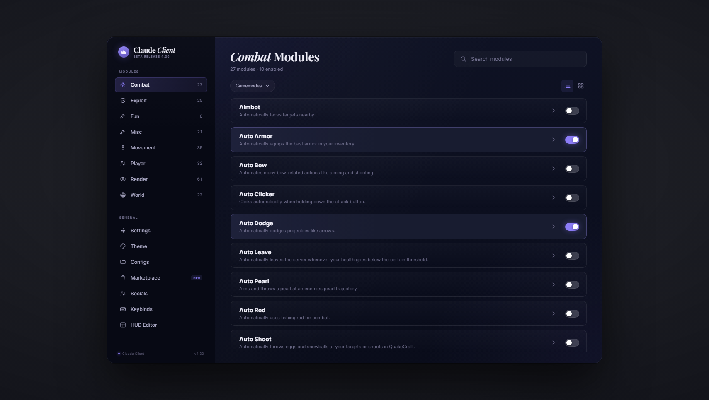
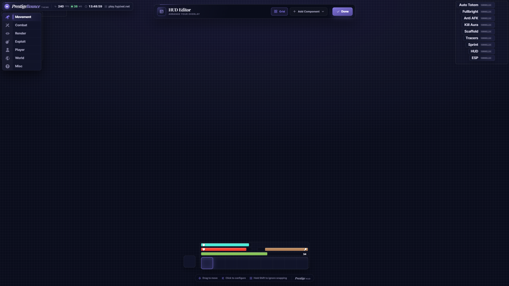
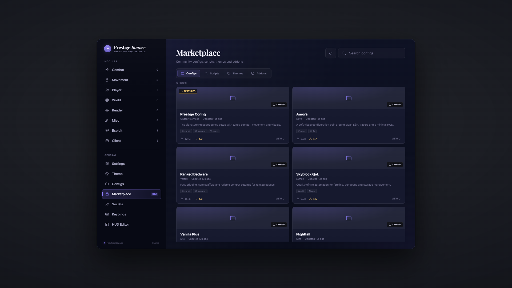
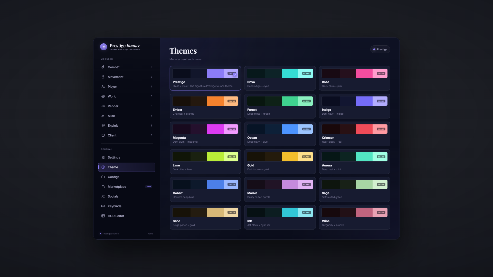
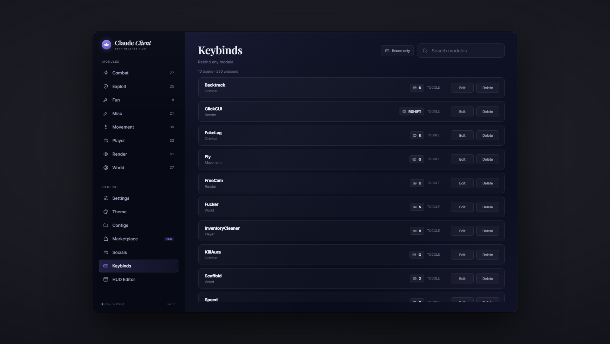
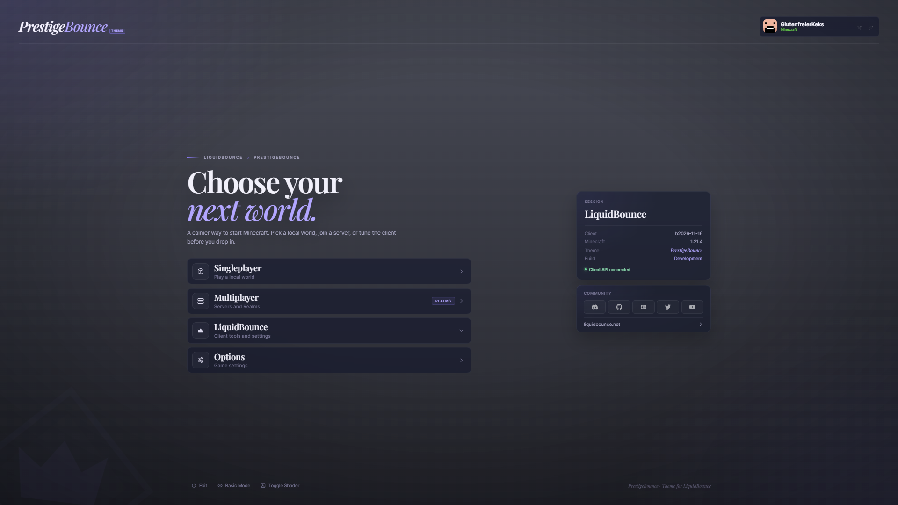
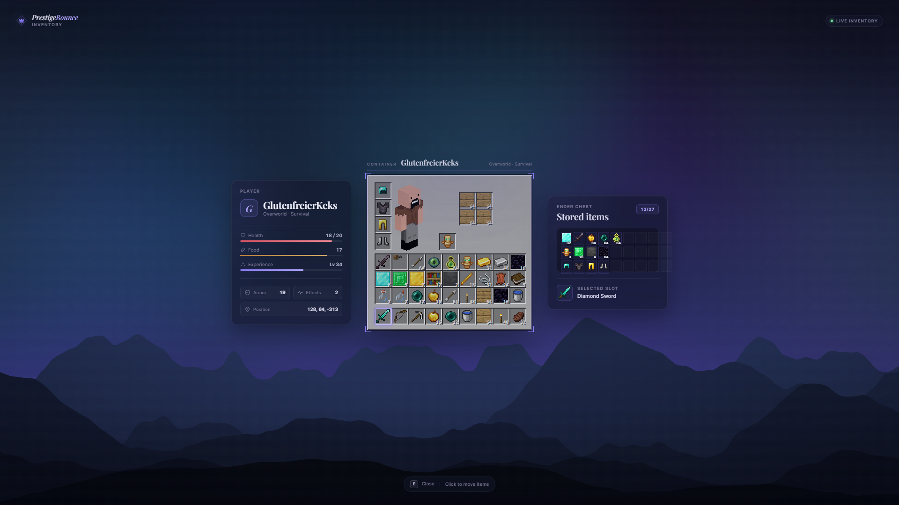
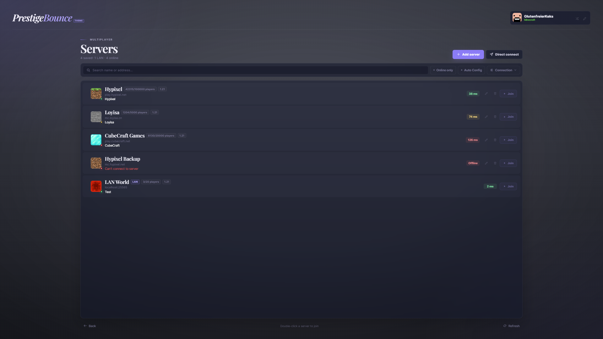
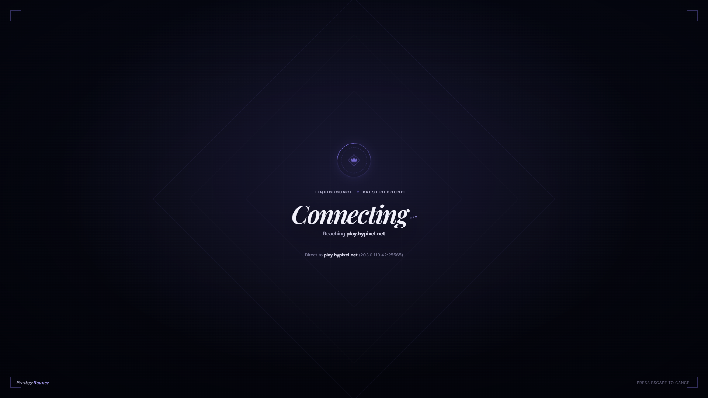
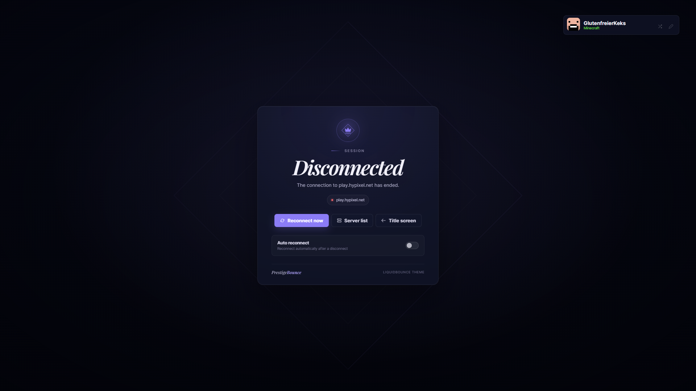

<div align="center">

# Prestigebounce

**A LiquidBounce theme inspired by the Prestige client GUI.**

Deep navy surfaces, soft violet accents and editorial typography — wrapped around a complete ClickGUI, HUD editor, animated loading screen and every client screen. Powered entirely by live LiquidBounce data.

[](https://svelte.dev/)
[](https://www.typescriptlang.org/)
[](https://vite.dev/)
[](https://liquidbounce.net/)

[Overview](#overview) · [Screenshots](#screenshots) · [Installation](#installation) · [Development](#development) · [Building](#building) · [Project structure](#project-structure)

</div>


## Overview

Prestigebounce is a complete UI overhaul for LiquidBounce, inspired by the clean, modern look of the Prestige client GUI. It replaces the default interface with a calm, editorial design: a deep navy canvas, muted violet accents, elegant serif headings paired with Inter, and generous spacing that keeps even dense module lists easy to read.

The theme is built entirely on real LiquidBounce data. Modules, settings, keybinds, configs, HUD elements and marketplace content are loaded through the client's REST API and synchronized over WebSocket, so toggles, bind changes and HUD values update live while the interface is open. Nothing is mocked or hardcoded.

Motion is used sparingly: menus, module cards, HUD elements and overlays fade and slide into place, while every interactive control keeps the exact position and size of the static layout.

### ClickGUI

- Custom sidebar with live module categories and counts
- Search across every module, with list and grid layouts
- Module cards with descriptions, enable toggles and per-module settings
- Dedicated views for Settings, Themes, Configs, Marketplace, Socials and Keybinds
- Built-in HUD editor accessible straight from the sidebar
- Toast feedback for module toggles, saves, binds and marketplace actions
- Staggered entrances, animated view changes and hover/press feedback without moving any controls

### HUD editor

- Drag-and-drop canvas with grid overlay and snapping
- Per-element settings, enable/disable toggles and live previews
- Add, arrange and configure every supported HUD component
- Animated editor chrome, anchor guides and selection feedback
- Layout persists across sessions and updates immediately in-game

### Client screens

- Reworked title screen with session and community panels
- Singleplayer world browser with search and filters
- Multiplayer server list with status, ping, favorites and direct connect
- Alt manager with search, account types and account actions
- Proxy manager with search, filters and quick actions
- Connecting and disconnected screens with branded progress and session details
- Shared header actions for fast navigation between client screens
- Inventory, container and browser overlays in the same visual language

### HUD components

`Watermark` · `FPS` · `Ping` · `Coordinates` · `PlayerInfo` · `TabGui` · `ArrayList` · `Notifications` · `Hotbar` · `Scoreboard` · `ArmorItems` · `InventoryStatistics` · `Inventory` · `CraftingInventory` · `EnderChestInventory` · `TargetHud` · `BlockCounter` · `Effects` · `Keystrokes` · `Taco` · `Image` · `Text` · `KeyBinds` · `ClosedCaptions`

### Loading screen

- Animated splash built around the Prestige mark and wordmark
- Accent-tinted progress treatment with the theme's navy background
- Configured through the theme manifest, so it appears before the client UI loads

### Inventory and overlays

- Custom inventory overlay that follows vanilla slot geometry
- Player panel with health, food, experience, armor, effects and position
- Container and Ender Chest panels driven by live slot data
- Transparent presentation with pointer events passing through to the game
- Matching connecting, disconnected and browser overlays

### Motion

- Staggered module and navigation entrances in the ClickGUI
- Animated view changes, tag menus, view switches and toast feedback
- HUD component entrances plus watermark, hotbar, TabGUI and notification accents
- Motion never reflows the ClickGUI or HUD — every control keeps its static size and position

### Customization

- 22 built-in color palettes, from the signature violet to muted earth tones
- Custom accent color that applies instantly across the whole interface
- Optional spaced module names in the ClickGUI, ArrayList and HUD
- Playfair Display for display type and Inter for UI text
- Animated splash screen, custom backgrounds and sound design

## Screenshots

| ClickGUI | HUD Editor |
| :---: | :---: |
|  |  |

| Marketplace | Themes |
| :---: | :---: |
|  |  |

| Keybinds | Settings |
| :---: | :---: |
|  |  |

| Title screen | Inventory overlay |
| :---: | :---: |
|  |  |

| Multiplayer | Singleplayer |
| :---: | :---: |
|  |  |

| Alt Manager | Proxy Manager |
| :---: | :---: |
|  |  |

| Connecting | Disconnected |
| :---: | :---: |
|  |  |

## Installation

### Install a build

1. Download the latest release of Prestigebounce.
2. Open your LiquidBounce themes folder:

    ```text
    .client theme browse
    ```

3. Extract the release into its own folder, for example `prestigebounce`.
4. Reload the theme list and activate the theme:

    ```text
    .client theme reload
    .client theme set prestigebounce
    ```

### Build from source

```bash
git clone https://github.com/GlutenfreierKeks/PrestigeBounce.git
cd PrestigeBounce
npm install
npm run build
```

Copy the contents of the generated `dist` folder into `themes/prestigebounce`, then reload and apply the theme in-game.

## Development

### Prerequisites

- Node.js (latest LTS or stable release recommended)
- A running LiquidBounce client

### Setup

1. Install dependencies:

    ```bash
    npm install
    ```

2. Start LiquidBounce before launching the dev server.

3. Start the development server:

    ```bash
    npm run dev
    ```

4. Point the client at the live development URL:

    ```text
    .client theme set http://localhost:5173/
    ```

5. Open any interface in your browser:

    ```text
    .client integration menu
    ```

Vite hot reloads the UI as you edit. The client connection stays live, so module toggles, settings and HUD values update without reopening the interface.

### Local testing

The fastest way to explore the theme without starting Minecraft is the bundled mock preview:

```bash
npm run dev:local
```

This starts a mock LiquidBounce API, starts Vite and opens the title screen in your browser. The mock includes modules, settings, HUD components, inventory contents, servers, worlds, accounts, proxies and marketplace entries, so every screen is interactive.

Useful preview routes:

```text
http://localhost:5173/#/title?port=54812&static
http://localhost:5173/#/clickgui?port=54812&static
http://localhost:5173/#/hud?port=54812&static
http://localhost:5173/#/inventory?port=54812&static
```

Press `Ctrl+C` in the terminal to stop the mock and Vite. Set `NO_OPEN=1` to skip opening the browser, or override the ports with `VITE_PORT` and `MOCK_PORT`.

To test the current source directly inside LiquidBounce, keep `npm run dev` running and load the dev server in-game:

```text
.client theme set http://localhost:5173/
```

To install the built theme into your local LiquidBounce themes folder:

```bash
npm run install:local
```

The command creates `themes/prestigebounce-local` next to any marketplace installation. Then run:

```text
.client theme reload
.client theme set prestigebounce-local
```

Set `LIQUIDBOUNCE_DIR` if your client is installed somewhere other than the default LiquidLauncher directory.

### Useful commands

| Command | Description |
| --- | --- |
| `npm run dev` | Start the Vite development server |
| `npm run dev:local` | Start the mock API and Vite, then open the browser preview |
| `npm run install:local` | Build and install the theme into your local LiquidBounce folder |
| `npm run check` | Run Svelte and TypeScript diagnostics |
| `npm run build` | Create an optimized production build in `dist` |
| `npm run preview` | Preview the production build locally |

## Building

```bash
npm run check
npm run build
```

The production build is written to `dist`. It contains the optimized JavaScript and CSS bundles, fonts, icons, sounds, HUD component definitions and the theme manifest.

To install the build, copy the entire `dist` folder into your LiquidBounce themes directory, rename it to `prestigebounce`, and run:

```text
.client theme reload
.client theme set prestigebounce
```

## Marketplace publishing

Prestigebounce is published to the [LiquidBounce Marketplace](https://liquidbounce.net/marketplace) through GitHub Actions. Every push to `main` builds the theme, creates a tagged pre-release with the installable ZIP and uploads a new revision to the configured marketplace item.

The workflow reads `MARKETPLACE_ITEM_ID` and `ZIP_NAME` from `.github/workflows/build.yml` and authenticates with the `API_TOKEN` repository secret. New revisions are reviewed by the LiquidBounce team before they become the live version on the marketplace.

## Project structure

```text
PrestigeBounce/
├── dev/                       Local mock API and icon fixtures
├── docs/
│   └── screenshots/           README gallery
├── scripts/                   Local preview and theme installer
├── public/
│   ├── components/            HUD component definitions
│   ├── fonts/                 Playfair Display and Inter
│   ├── img/                   icons, flags and UI assets
│   ├── sounds/                splash sounds
│   ├── splash/                animated splash screen
│   └── metadata.json          theme manifest
├── src/
│   ├── components/            shared wordmark and logo components
│   ├── integration/           REST client, WebSocket events, router and helpers
│   ├── routes/
│   │   ├── clickgui/claude/   ClickGUI design system and views
│   │   ├── hud/               HUD renderer, elements and editor
│   │   ├── menu/              title, singleplayer, multiplayer, alt manager, proxy manager
│   │   ├── inventory/         inventory and container overlays
│   │   └── browser/           in-game browser overlay
│   ├── theme/                 shared theme configuration
│   ├── App.svelte             application shell
│   └── main.ts                entry point
├── index.html
├── package.json
└── vite.config.ts
```

## Credits

- Built on top of the [LiquidBounce default theme](https://github.com/CCBlueX/LiquidBounce-Theme) by CCBlueX.
- Interface design inspired by the Prestige client GUI.
- Typography: Playfair Display and Inter.

Prestigebounce is a fan-made theme and is not affiliated with Prestige or the LiquidBounce team.
