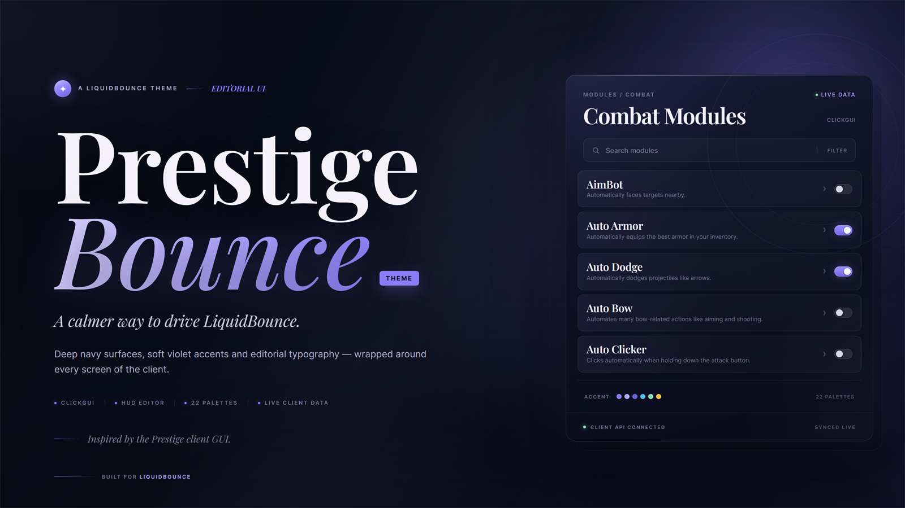
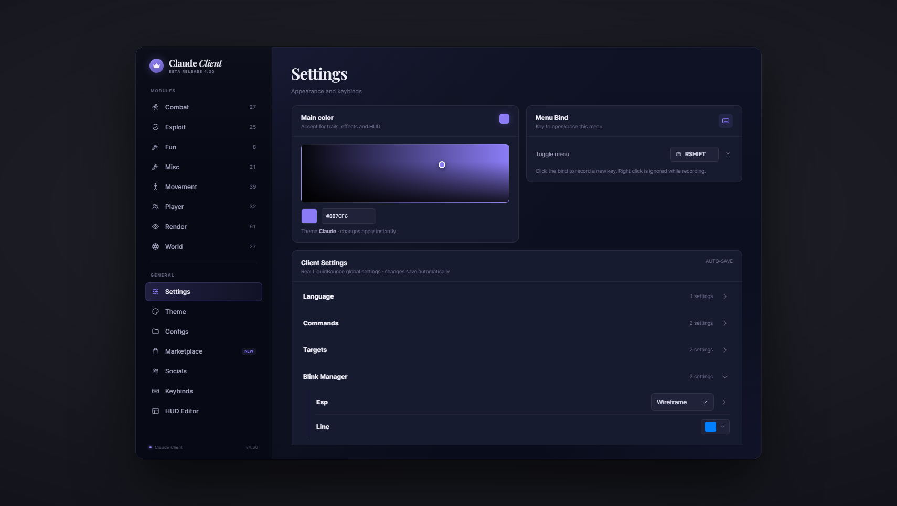
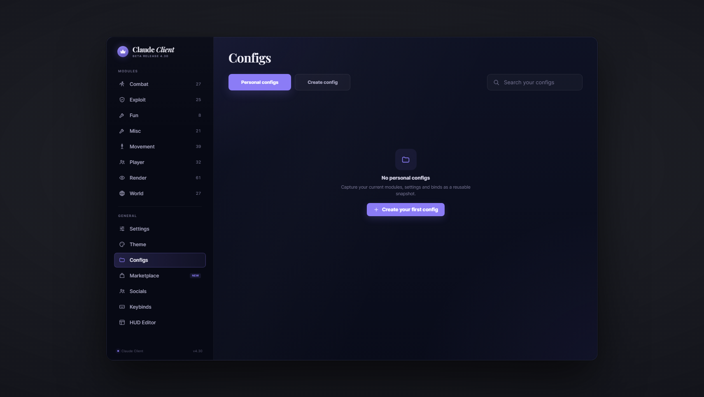
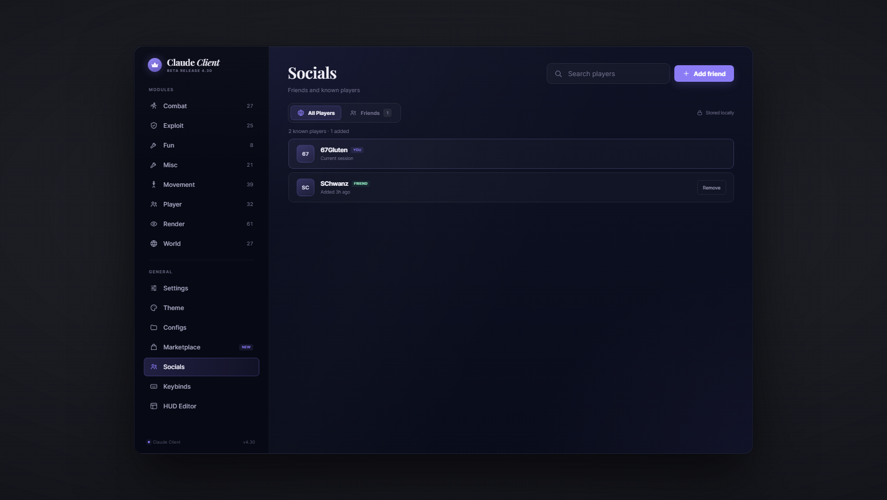
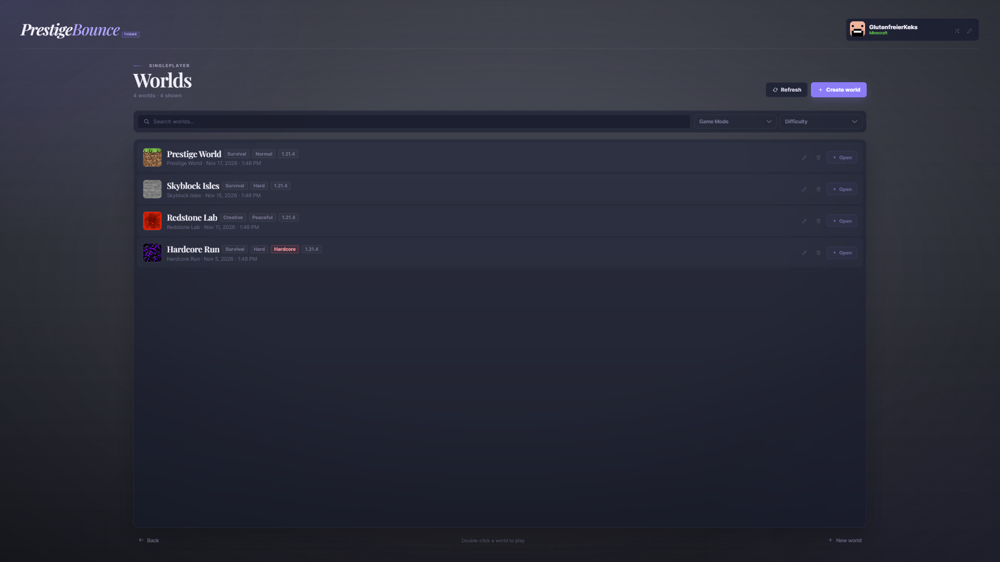
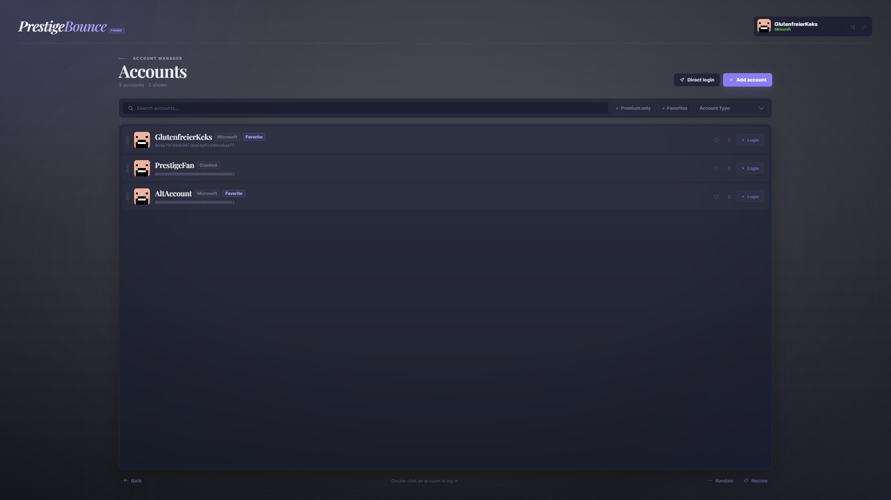
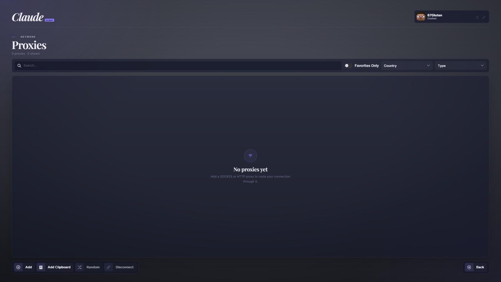

<div align="center">

# Prestigebounce

**A LiquidBounce theme inspired by the Prestige client GUI.**

Deep navy surfaces, soft violet accents and editorial typography — wrapped around a complete ClickGUI, HUD editor and every client screen. Powered entirely by live LiquidBounce data.

[](https://svelte.dev/)
[](https://www.typescriptlang.org/)
[](https://vite.dev/)
[](https://liquidbounce.net/)

[Overview](#overview) · [Screenshots](#screenshots) · [Installation](#installation) · [Development](#development) · [Building](#building) · [Project structure](#project-structure)

</div>



## Overview

Prestigebounce is a complete UI overhaul for LiquidBounce, inspired by the clean, modern look of the Prestige client GUI. It replaces the default interface with a calm, editorial design: a deep navy canvas, muted violet accents, elegant serif headings paired with Inter, and generous spacing that keeps even dense module lists easy to read.

The theme is built entirely on real LiquidBounce data. Modules, settings, keybinds, configs, HUD elements and marketplace content are loaded through the client's REST API and synchronized over WebSocket, so toggles, bind changes and HUD values update live while the interface is open. Nothing is mocked or hardcoded.

### ClickGUI

- Custom sidebar with live module categories and counts
- Search across every module, with list and grid layouts
- Module cards with descriptions, enable toggles and per-module settings
- Dedicated views for Settings, Themes, Configs, Marketplace, Socials and Keybinds
- Built-in HUD editor accessible straight from the sidebar
- Toast feedback for module toggles, saves, binds and marketplace actions

### HUD editor

- Drag-and-drop canvas with grid overlay and snapping
- Per-element settings, enable/disable toggles and live previews
- Add, arrange and configure every supported HUD component
- Layout persists across sessions and updates immediately in-game

### Client screens

- Reworked title screen with session and community panels
- Singleplayer world browser with search and filters
- Multiplayer server list with status, ping, favorites and direct connect
- Alt manager with search, account types and account actions
- Proxy manager with search, filters and quick actions
- Connecting, disconnected, inventory, container and browser overlays

### HUD components

`Watermark` · `FPS` · `Ping` · `Coordinates` · `PlayerInfo` · `TabGui` · `ArrayList` · `Notifications` · `Hotbar` · `Scoreboard` · `ArmorItems` · `InventoryStatistics` · `Inventory` · `CraftingInventory` · `EnderChestInventory` · `TargetHud` · `BlockCounter` · `Effects` · `Keystrokes` · `Taco` · `Image` · `Text` · `KeyBinds` · `ClosedCaptions`

### Customization

- 22 built-in color palettes, from the signature violet to muted earth tones
- Custom accent color that applies instantly across the whole interface
- Optional spaced module names in the ClickGUI, ArrayList and HUD
- Playfair Display for display type and Inter for UI text
- Animated splash screen, custom backgrounds and sound design

## Screenshots

| ClickGUI | HUD Editor |
| :---: | :---: |
|  |  |

| Marketplace | Keybinds |
| :---: | :---: |
|  |  |

| Themes | Settings |
| :---: | :---: |
|  |  |

| Configs | Socials |
| :---: | :---: |
|  |  |

| Multiplayer | Singleplayer |
| :---: | :---: |
|  |  |

| Alt Manager | Proxy Manager |
| :---: | :---: |
|  |  |

## Installation

### Install a build

1. Download the latest release of Prestigebounce.
2. Open your LiquidBounce themes folder:

    ```text
    .client theme browse
    ```

3. Extract the release into its own folder, for example `prestigebounce`.
4. Reload the theme list and activate the theme:

    ```text
    .client theme reload
    .client theme set prestigebounce
    ```

### Build from source

```bash
git clone https://github.com/GlutenfreierKeks/PrestigeBounce.git
cd PrestigeBounce
npm install
npm run build
```

Copy the contents of the generated `dist` folder into `themes/prestigebounce`, then reload and apply the theme in-game.

## Development

### Prerequisites

- Node.js (latest LTS or stable release recommended)
- A running LiquidBounce client

### Setup

1. Install dependencies:

    ```bash
    npm install
    ```

2. Start LiquidBounce before launching the dev server.

3. Start the development server:

    ```bash
    npm run dev
    ```

4. Point the client at the live development URL:

    ```text
    .client theme set http://localhost:5173/
    ```

5. Open any interface in your browser:

    ```text
    .client integration menu
    ```

Vite hot reloads the UI as you edit. The client connection stays live, so module toggles, settings and HUD values update without reopening the interface.

### Useful commands

| Command | Description |
| --- | --- |
| `npm run dev` | Start the Vite development server |
| `npm run check` | Run Svelte and TypeScript diagnostics |
| `npm run build` | Create an optimized production build in `dist` |
| `npm run preview` | Preview the production build locally |

## Building

```bash
npm run check
npm run build
```

The production build is written to `dist`. It contains the optimized JavaScript and CSS bundles, fonts, icons, sounds, HUD component definitions and the theme manifest.

To install the build, copy the entire `dist` folder into your LiquidBounce themes directory, rename it to `prestigebounce`, and run:

```text
.client theme reload
.client theme set prestigebounce
```

## Marketplace publishing

To publish Prestigebounce to the [LiquidBounce Marketplace](https://liquidbounce.net/marketplace):

1. Generate an API token at [liquidbounce.net/account](https://liquidbounce.net/account).
2. Copy the marketplace item ID from your item page.
3. Add `API_TOKEN` as a repository secret under **Settings → Secrets and variables → Actions**.
4. Set `MARKETPLACE_ITEM_ID` and `ZIP_NAME` in `.github/workflows/build.yml`.
5. Uncomment the GitHub release and marketplace upload steps in that workflow.

Once configured, the workflow builds and publishes the theme automatically when triggered.

## Project structure

```text
PrestigeBounce/
├── docs/
│   └── screenshots/           README gallery
├── public/
│   ├── components/            HUD component definitions
│   ├── fonts/                 Playfair Display and Inter
│   ├── img/                   icons, flags and UI assets
│   ├── sounds/                splash sounds
│   ├── splash/                animated splash screen
│   └── metadata.json          theme manifest
├── src/
│   ├── components/            shared wordmark and logo components
│   ├── integration/           REST client, WebSocket events, router and helpers
│   ├── routes/
│   │   ├── clickgui/claude/   Claude design system and ClickGUI views
│   │   ├── hud/               HUD renderer, elements and editor
│   │   ├── menu/              title, singleplayer, multiplayer, alt manager, proxy manager
│   │   ├── inventory/         inventory and container overlays
│   │   └── browser/           in-game browser overlay
│   ├── theme/                 shared theme configuration
│   ├── App.svelte             application shell
│   └── main.ts                entry point
├── index.html
├── package.json
└── vite.config.ts
```

## Credits

- Built on top of the [LiquidBounce default theme](https://github.com/CCBlueX/LiquidBounce-Theme) by CCBlueX.
- Interface design inspired by the Prestige client GUI.
- Typography: Playfair Display and Inter.

Prestigebounce is a fan-made theme and is not affiliated with Prestige or the LiquidBounce team.
